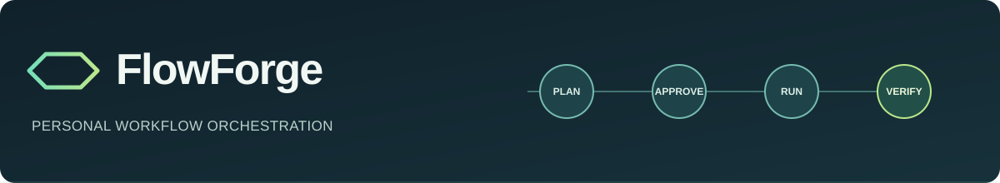
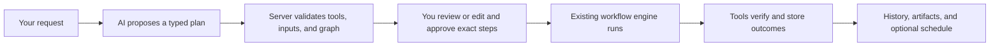

# FlowForge

**Plan your work, automate the repeatable parts, and see what actually happened.**

FlowForge is a private, local-first workspace for tasks, study sessions, documents, reminders, and approved AI-assisted automations. It combines everyday planning with a persistent workflow engine, so an automation can read real records, ask for approval, execute registered actions, and report a verified outcome.

> **Project status:** Locally runnable and covered by backend and frontend tests. Optional AI features require your own compatible provider credentials. No hosted instance, live provider verification, or general external-service connector is claimed.

## Why FlowForge?

Productivity apps often store tasks without helping you turn them into a plan. Automation demos often show a generated answer without proving an action happened. FlowForge keeps the two together: your tasks and documents are the source of truth, plans are reviewable before execution, and run history records the steps, failures, and saved results.

## What works today

| Area | Implemented behavior |
| --- | --- |
| **Tasks and reminders** | Create, edit, complete, search, prioritize, and schedule tasks. In-app alerts and recurrence are stored in SQLite. |
| **Study planning** | Manage subjects and study sessions, mark sessions complete, and review planned study time. |
| **Documents** | Upload PDF, TXT, Markdown, and CSV files; retain originals; extract and search text; request an optional provider-backed summary. |
| **Personal automations** | Describe a goal in plain language, receive a typed proposal, edit steps and schedules, approve the exact plan, run it, and inspect verified output. |
| **Registered tools** | Read and update local tasks, prepare daily and weekly plans, inspect study and document records, create notifications, and save generated artifacts. |
| **Workflow engine** | Run validated dependency graphs with manual approval gates, bounded retries, cancellation, attempt history, and one-time or recurring schedules. |
| **Developer view** | Read-only GitHub activity when a token and owner are configured. |
| **Diagnostics** | Structured request logs, process-local metrics, a synthetic benchmark, and SQLite backup tooling. |

**Honest boundaries:** Extracted document dates are *candidates* for review; they do not silently create tasks. The app does not run arbitrary shell/Python/SQL, browse websites, send email, or write to GitHub. A general HTTP connector is intentionally unavailable until destination validation and SSRF defenses are complete.

## How an automation runs



For example, “Read my unfinished tasks, prioritize them, and save a daily plan” can use `tasks.list_open` → `plans.daily` → `artifacts.save`. The saved artifact contains task IDs read from the database. The test suite exercises this whole path with a mocked planner and a real temporary SQLite database.

## Technology

| Layer | Choice |
| --- | --- |
| Interface | React 19, TypeScript, Vite, Lucide icons, responsive CSS |
| API | Python 3.11+, FastAPI, Pydantic, Uvicorn |
| Storage | SQLite and local document files |
| Execution | Async dependency-graph engine and one in-process scheduler with persisted schedule state |
| Document processing | `pypdf` and local text extraction |
| Optional AI | OpenAI-compatible chat-completions endpoint, configured through environment variables |
| Tests and checks | pytest, FastAPI TestClient, Vitest, React Testing Library, TypeScript build, GitHub Actions |

The default configuration binds the development API and UI to loopback. No sample data is inserted on startup.

## Run locally

### Requirements

- **Python 3.11 or later** (3.12 is used in CI)
- **Node.js 20.19+ or 22.12+** and npm (Node 22 is used in CI)
- Windows PowerShell for the one-command launcher, or two terminals on any platform
- Free local ports **8000** (API) and **5173** (UI)

### Windows: one command

```powershell
git clone https://github.com/Surabin123/FlowForge.git
Set-Location FlowForge
powershell -ExecutionPolicy Bypass -File .\run.ps1
```

`run.ps1` creates `.env` from `.env.example`, creates a Python virtual environment if needed, installs dependencies, then starts the API and Vite UI. Open **http://127.0.0.1:5173**. The API health check is **http://127.0.0.1:8000/api/health**. Stop the launcher with Ctrl+C.

### Any platform: separate terminals

From the repository root:

```bash
python -m venv .venv
# Windows PowerShell: .venv\Scripts\Activate.ps1
# macOS/Linux: source .venv/bin/activate
python -m pip install -r requirements.txt
cp .env.example .env
npm --prefix frontend ci
```

Start the API in one terminal:

```bash
python -m uvicorn app.main:app --app-dir backend --host 127.0.0.1 --port 8000
```

Start the UI in another:

```bash
npm --prefix frontend run dev
```

On Windows, use `Copy-Item .env.example .env` instead of `cp` if your shell does not provide that alias.

## Configure optional integrations

Edit the ignored `.env` file; never commit it.

| Variable | When needed |
| --- | --- |
| `FLOWFORGE_AI_API_KEY`, `FLOWFORGE_AI_MODEL` | New natural-language proposals, document summaries, and deadline candidates |
| `FLOWFORGE_AI_BASE_URL` | Only if your compatible provider uses a different API base URL |
| `FLOWFORGE_GITHUB_TOKEN`, `FLOWFORGE_GITHUB_OWNER` | Read-only developer activity |
| `FLOWFORGE_TIMEZONE` | Local recurrence calculations; default `Asia/Calcutta` |
| `FLOWFORGE_DATABASE`, `FLOWFORGE_DOCUMENTS` | Override local database and upload locations |
| `FLOWFORGE_REQUIRE_AUTH`, `FLOWFORGE_ACCESS_TOKEN` | Required if you deliberately expose a remote service |

Without AI credentials, tasks, study planning, uploads, reminders, local workflows, and already-approved local-tool automations remain usable. When an AI feature is used, its request or selected document text goes to the configured provider; review that provider’s data policy first. See [.env.example](.env.example) for all limits and defaults.

## Project structure

```text
backend/app/           FastAPI routes, persistence, scheduler, engine, planner, tool registry
backend/tests/         API, workflow, scheduler, document, and automation tests
frontend/src/          React workspace and automation interface
docs/                  Architecture, decisions, engineering audit, benchmark, deployment guide
.github/workflows/     CI checks
run.ps1                Windows development launcher
Dockerfile             Optional single-service container build
render.yaml            Optional Render blueprint; deployment is not verified
```

Start with the [feature walkthrough](docs/USAGE.md) for day-to-day flows. The key design choices and state transitions are in [architecture and operations](docs/ARCHITECTURE.md). The [automation decision record](docs/decisions/006-approved-tool-automations.md) explains the approval boundary. [Project status](PROJECT_STATUS.md) distinguishes tested work from unsupported features.

## Verify the project

```bash
python -m pytest backend/tests -q
python -m compileall -q backend/app
npm --prefix frontend test
npm --prefix frontend run build
```

The most recent local run passed **37 backend tests** and **7 frontend tests**, plus Python compilation and a TypeScript/Vite production build. GitHub Actions runs these checks for pushes and pull requests to `main`. The provider tests use deterministic mocks; a live AI service and a remote deployment have not been verified.

The [benchmark report](docs/benchmarks/README.md) is synthetic and local. It is not a hosted-capacity claim.

## Data, security, and operating limits

- SQLite and uploaded originals stay on your machine by default and are ignored by Git.
- The optional access-token gate is intended for an explicitly configured remote deployment; local development binds to `127.0.0.1`.
- Plans can use only versioned registered tools. The server validates inputs and dependencies; editing invalidates approval. Tool dispatch checks the approved run snapshot.
- Local writes are checked after storage, and supported actions use run/node deduplication. A failed run that attempted a write or external request is **not** blindly replayed.
- The scheduler runs inside one API process with SQLite. It handles persisted due work and duplicate occurrence claims, but it is not a distributed queue or high-availability service.
- Process-local metrics reset on restart. There is no production tracing backend or Kubernetes deployment.

For backup and optional hosting details, read the [Render deployment guide](docs/DEPLOYMENT_RENDER.md). Its configuration is present, but no Render build or live deployment has been verified.

## Troubleshooting

| Symptom | Check |
| --- | --- |
| UI cannot reach the API | Confirm ports 5173 and 8000 are free and `/api/health` returns `ok`. |
| AI proposal or summary unavailable | Set the AI key and model in `.env`, restart the API, and check the selected provider base URL. |
| Upload rejected | Use PDF, TXT, Markdown, or CSV and stay within `FLOWFORGE_MAX_UPLOAD_MB`. |
| A run was interrupted | Inspect saved node outcomes and failure reasons before starting another run. |
| A scheduled automation did not run | Keep the API process running; inspect whether its saved schedule is enabled and when the next occurrence is due. |

FlowForge is a personal project under active development. The repository does not currently declare an open-source license.
