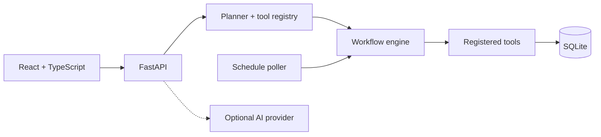

# FlowForge

[](https://github.com/Surabin123/FlowForge/actions/workflows/ci.yml)


## Automate workflows. Verify every outcome.

FlowForge is a local-first workspace that connects personal tasks, study plans, and documents to **reviewed, persistent automations**. It turns a request into explicit steps, runs only approved tools, and records what actually succeeded or failed.

[Explore the product walkthrough →](docs/USAGE.md)

## The problem

A task list can tell you what is due, but it does not prepare the work. An AI response can suggest a plan, but that is not evidence that any action happened. FlowForge keeps the plan, permission decision, execution, and outcome in one traceable workflow.

## Core capabilities

- **Personal workspace:** Tasks, recurring reminders, study sessions, document uploads, search, and optional AI summaries.
- **Plan and approve:** Natural-language requests become typed workflow proposals; edits invalidate the previous approval.
- **Execute and inspect:** A dependency-aware engine runs registered tools with attempt history, manual gates, cancellation, and saved results.
- **Schedule repeatable work:** One-time and recurring schedules use persisted SQLite state and deduplicate due occurrences.

## A real automation path

> “Read my unfinished tasks, prioritize them, and save a daily plan.”

The configured AI provider proposes `tasks.list_open → plans.daily → artifacts.save`. FlowForge validates the tool IDs, inputs, and dependencies; the user approves the exact plan. The engine then reads actual task rows, orders them by priority and due date, saves an artifact, and confirms that it can be read back. The integration test exercises this path with a mocked planner and a real temporary SQLite database.

## Architecture



The API owns planning, validation, and the execution boundary. SQLite stores proposals, approvals, runs, attempts, schedules, and application records; uploaded originals stay on the local filesystem. The scheduler and engine run in one API process. See the [architecture guide](docs/ARCHITECTURE.md) for state transitions and limits.

## Engineering highlights

- **Explicit authority:** The model selects from versioned, schema-validated tools. A hash binds user approval to the plan and schedule; dispatch checks the approved run snapshot.
- **Durable evidence:** Node attempts, errors, and outputs persist. Local writes are read back; document-extracted dates remain labeled as candidates.
- **Controlled failure handling:** Transient retries are bounded. Run/node deduplication protects supported local writes, and attempted side effects block blind whole-run replay.
- **Visible operations:** Structured logs and process-local metrics support debugging; tests use temporary databases and mocked providers.

## Stack

| Interface | Service | Storage and execution |
| --- | --- | --- |
| React 19, TypeScript, Vite | FastAPI, Pydantic, Python 3.11+ | SQLite, local files, async workflow engine |

## Quick start

Requires Python 3.11+, Node.js 20.19+ or 22.12+, npm, and free local ports 8000 and 5173. On Windows PowerShell:

```powershell
git clone https://github.com/Surabin123/FlowForge.git
Set-Location FlowForge
powershell -ExecutionPolicy Bypass -File .\run.ps1
```

Open **http://127.0.0.1:5173**. The launcher creates a local virtual environment and `.env`, installs dependencies, and starts the API and UI. For macOS/Linux, separate-terminal commands, configuration defaults, and troubleshooting, use the [operations guide](docs/OPERATIONS.md).

## Documentation

- [Product walkthrough](docs/USAGE.md) — everyday features and an approved automation example
- [Architecture](docs/ARCHITECTURE.md) — component boundaries, state transitions, scheduling, and recovery
- [Operations](docs/OPERATIONS.md) — setup, environment variables, tests, storage, and troubleshooting
- [Engineering audit](docs/ENGINEERING_AUDIT.md) — implementation trade-offs and measured local benchmark context
- [Render deployment guide](docs/DEPLOYMENT_RENDER.md) — optional hosting prerequisites, costs, backup, and rollback
- [Project status](PROJECT_STATUS.md) — verified work and remaining gaps

## Verification and scope

The local CI configuration runs backend tests, frontend tests, Python compilation, lint, a TypeScript/Vite build, and a Playwright browser smoke test. The current local audit passed **47 backend** tests, **8 frontend** tests, and **1 browser** test. AI-provider calls in the test suite are mocked; no live AI result or Render deployment has been verified.

FlowForge is designed for one user and one API process. It has no general external HTTP connector, email/calendar action, distributed scheduler, or high-availability claim. The repository does not declare an open-source license.
